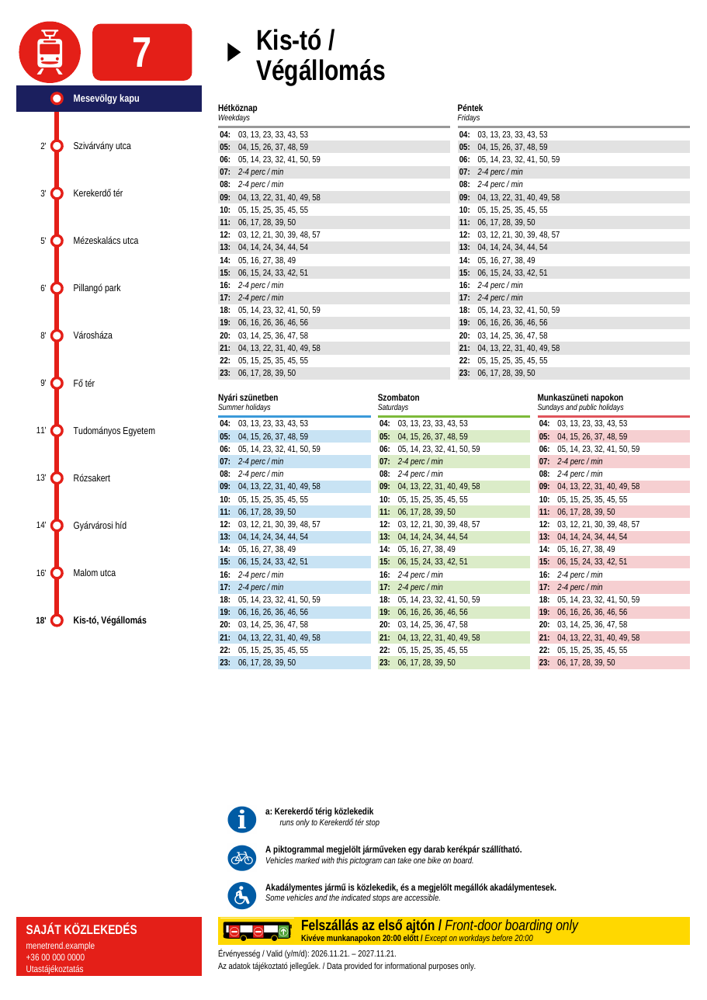
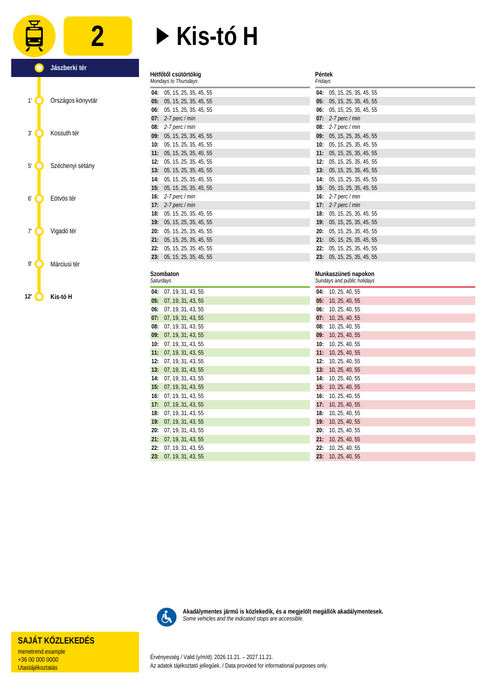

# Menetrend tervező

Tableten (Android) futó program saját, kitalált menetrendek szerkesztésére és A4-es PDF-be mentésére.
Python + Kivy; a PDF-et reportlab rajzolja (vektoros).

## Így néz ki a kimenet

A program által készített PDF-ek (valódi kimenet, kitalált adatokkal). Kattintásra a PDF is letölthető:

| [7-es villamos – 2 soros végállomás, minden jelzéssel](docs/minta-7-villamos.pdf) | [2-es villamos – 1 soros végállomás, sárga vonal](docs/minta-2-villamos.pdf) |
|:--:|:--:|
|  |  |

## Használat
1. **Járat** fül: jármű típusa (villamos / busz / trolibusz), járatszám, szín, irány, érvényesség kezdete és hossza (alapból 1 év).
2. **Megállók** fül: megállók neve és menetideje az első megállótól.
3. **Menetrend** fül: legfeljebb 2 sor × 3 oszlop blokk (pl. hétköznap / péntek / szombat…); óránként a percek.
   „Gyors kitöltés” és „másolás másik blokkból” segít.
4. **Jelzések** fül: kerékpár és akadálymentes piktogram, első ajtós felszállás sáv (be/ki), infóblokk (be/ki), lábjegyzetek.
5. **Előnézet** fül: az aktuális adatokból friss PDF-et rajzol és képként mutatja (nagyítható, görgethető; Androidon a beépített PdfRenderer-rel).
6. **PDF** fül: generálás → Android: Letöltések mappa; innen megnyitható és nyomtatható.

## APK építése (nem kell hozzá saját Linux gép)
1. Hozz létre egy GitHub-tárat, töltsd fel ennek a mappának a tartalmát (a `main` ágra).
2. A GitHubon: **Actions → APK építése → Run workflow** (a push is elindítja).
3. Kb. 15–30 perc után az **Artifacts → menetrend-apk** alatt letölthető az `.apk`.
4. A tableten engedélyezni kell az ismeretlen forrásból telepítést, majd az APK megnyitható.

Helyi építés (Linux/WSL): `pip install buildozer` majd `buildozer android debug` a mappában.

## Asztali kipróbálás
`pip install kivy reportlab pillow` → `python main.py` (a PDF a ~/Downloads mappába kerül).

## Tesztek (Kivy nélkül futnak)
`python tests/test_pdf.py <kimeneti_mappa>` és `python tests/test_ui_logic.py`.

## Megjegyzések
- Betűtípus: Liberation Sans Narrow (SIL OFL), a `assets/fonts` mappában.
- A járatjel-piktogramok az eredeti BKK-s mintalapokról lettek kivágva, saját célra.
