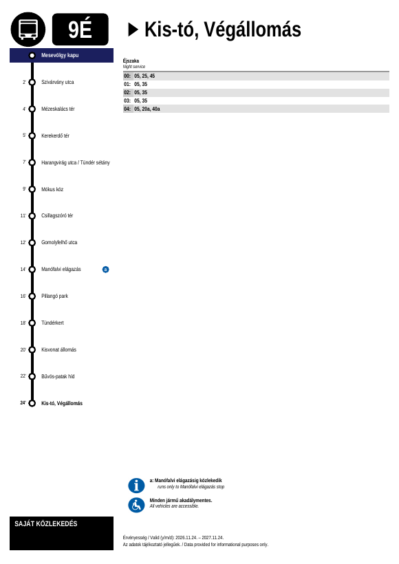

# Menetrend tervező

Tableten (Android) futó program saját, kitalált menetrendek szerkesztésére és A4-es PDF-be mentésére.
Python + Kivy; a PDF-et reportlab rajzolja (vektoros).

## Letöltés (kész APK)

A lefordított Android-alkalmazás (`menetrend-tervezo.apk`) a tár **[Releases](../../releases/latest)** oldalán tölthető le, a legfrissebb kiadás **Assets** részéből. Nem kell hozzá semmit építeni.

Telepítés Android-tabletre:
1. Nyisd meg a Releases oldalt a tabletről, és töltsd le a `menetrend-tervezo.apk` fájlt.
2. Nyisd meg a letöltött fájlt, és engedélyezd az ismeretlen forrásból telepítést, ha az Android rákérdez.
3. Az APK nem a Play Áruházból származik, ezért a Play Protect figyelmeztetést mutathat – a telepítés ettől még folytatható.

Minden módosítás után a GitHub automatikusan új kiadást készít, a legnagyobb sorszámú a legfrissebb.

## Így néz ki a kimenet

A program által készített PDF-ek (valódi kimenet, kitalált adatokkal). Kattintásra a PDF is letölthető:

| [7-es villamos – 2 soros végállomás, minden jelzéssel](docs/minta-7-villamos.pdf) | [2-es villamos – 1 soros végállomás, sárga vonal](docs/minta-2-villamos.pdf) |
|:--:|:--:|
|  |  |

| [9É éjszakai járat (kitalált) – fekete jel, lista-szerű menetrend](docs/minta-9e-ejszakai.pdf) |
|:--:|
|  |

## Használat
1. **Járat** fül: jármű típusa (villamos / busz / trolibusz / éjszakai), járatszín (fekete is), járatszám, szín, irány, érvényesség kezdete és hossza (alapból 1 év).
2. **Megállók** fül: megállók neve, menetideje az első megállótól, és elhagyható kék jel (pl. „a”) a megálló mellett.
3. **Menetrend** fül: 0–24 óráig kitölthető (a lapon a 4–23 sor mindig látszik, a 0–3 és 24 csak ha kitöltöd; éjszakai járatnál csak a kitöltött órák, lista-szerűen); legfeljebb 2 sor × 3 oszlop blokk (pl. hétköznap / péntek / szombat…); óránként a percek.
   „Gyors kitöltés” és „másolás másik blokkból” segít.
4. **Jelzések** fül: kerékpár és akadálymentes piktogram, első ajtós felszállás sáv (be/ki), infóblokk (be/ki), lábjegyzetek (ikonnal: info vagy akadálymentes, vagy ikon nélkül).
5. **Előnézet** fül: az aktuális adatokból friss PDF-et rajzol és képként mutatja (nagyítható, görgethető; Androidon a beépített PdfRenderer-rel).
6. **PDF** fül: generálás → Android: Letöltések mappa; innen megnyitható és nyomtatható.

## APK saját építése (ha módosítanád a kódot)
1. Hozz létre egy GitHub-tárat, töltsd fel ennek a mappának a tartalmát (a `main` ágra).
2. A GitHubon: **Actions → APK építése → Run workflow** (a push is elindítja).
3. Kb. 15–30 perc után az **Artifacts → menetrend-apk** alatt letölthető az `.apk`.
4. A tableten engedélyezni kell az ismeretlen forrásból telepítést, majd az APK megnyitható.

Helyi építés (Linux/WSL): `pip install buildozer` majd `buildozer android debug` a mappában.

## Asztali kipróbálás
`pip install kivy reportlab pillow` → `python main.py` (a PDF a ~/Downloads mappába kerül).

## Tesztek (Kivy nélkül futnak)
`python tests/test_pdf.py <kimeneti_mappa>` és `python tests/test_ui_logic.py`.

## Megjegyzések
- Betűtípus: Liberation Sans Narrow (SIL OFL), a `assets/fonts` mappában.

## Jogi nyilatkozat / felhasználási feltételek
- **Nem hivatalos, független hobbiprojekt.** A program és az általa készített lapok nincsenek kapcsolatban a Budapesti Közlekedési Központtal (BKK), a BKV Zrt.-vel vagy bármely közlekedési szolgáltatóval, nem tőlük származnak, és nincs a jóváhagyásukkal. A BKK, a BKV, a „Budapest" és más említett nevek, jelek, logók a jogtulajdonosaik védjegyei vagy tulajdonai; ezeket a program nem tartalmazza és nem használja.
- **Grafikák.** A tárban lévő piktogramok és a menetrendlapok kialakítása közlekedési tájékoztató anyagok mintájára, ahhoz hasonlóan készült, egyes elemek (pl. járatjelek, jelmagyarázat-ikonok) az eredeti tájékoztató lapokról származnak. Ezekre a jogok az eredeti jogtulajdonosokat illetik; **a tulajdonjog nem száll át, és semmilyen felhasználási jogot nem adok rájuk.** A grafikák kizárólag **saját, személyes, nem üzleti célú** felhasználásra (tanulás, hobbi, makettezés, játék, házi nyomtatás) szolgálnak. **Tilos** őket kereskedelmi célra használni, értékesíteni, nyilvánosan terjeszteni vagy közzétenni, illetve olyan módon felhasználni, amely a jogtulajdonosok nevében vagy hivatalos anyagként tüntetné fel az eredményt.
- **Kitalált adatok.** A programmal készített menetrendek kitalált, szemléltető jellegűek. Ne tedd ki őket valódi megállóba, járműre vagy más nyilvános helyre, és ne add elő valódi menetrendként, mert ez megtévesztő lehet. Az útvonalak, megállók és időpontok nem valós közlekedési adatok.
- **Felelősség.** A szoftver „ahogy van" alapon, minden garancia nélkül áll rendelkezésre. A használatából eredő károkért a szerző nem vállal felelősséget. A használó maga felel azért, hogy az elkészített anyagokat jogszerűen használja.
- **Eltávolítás.** Ha jogtulajdonos úgy látja, hogy valamely elem a jogait sérti, jelezze a tár Issues oldalán, és az érintett elemet haladéktalanul eltávolítom.
- **Harmadik fél komponensei:** Liberation Sans Narrow betűtípus (SIL Open Font License 1.1), reportlab (BSD), Kivy (MIT), Pillow (HPND). Ezek a saját licencük szerint használhatók.
- Ez a szöveg általános tájékoztatás, nem jogi tanács.
